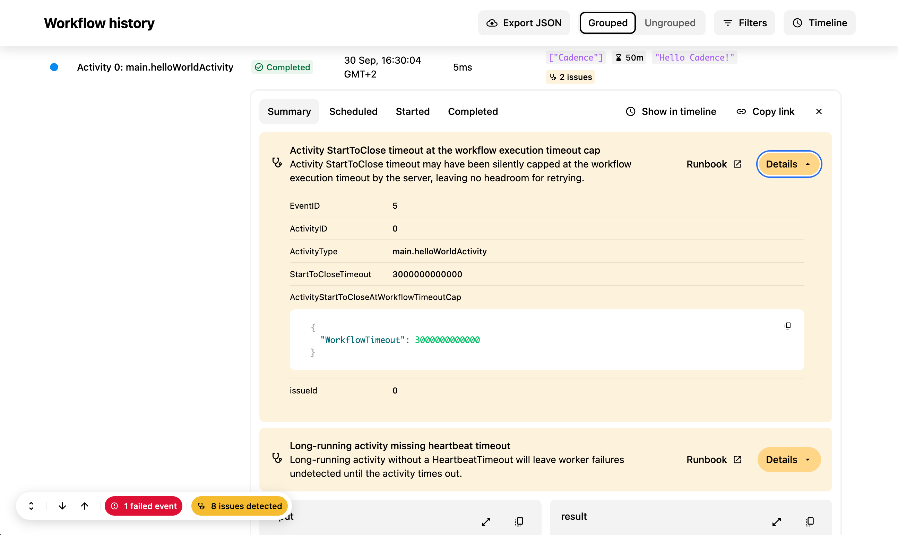

[Workflow Diagnostics](/blog/2025/08/06/workflow-diagnostics) scans a workflow's history, finds what went wrong, and tells you how to fix it. Until now, the results lived on their own page. You read an issue there, then went back to the history to find the event it was about.

Now Diagnostics is part of Workflow History. Issues show up on the events that caused them, so you can debug a workflow in one place.

<!-- truncate -->

## What's New

### Issues on the events that caused them

When Diagnostics finds an issue, the event that caused it is highlighted in its summary row. Expand the event to see the issue, the likely root cause, and a link to a runbook with steps to fix it.

Some issues are about the workflow as a whole rather than one event. These show up on the **Workflow Started** event.



### Find issues fast

A long history can have thousands of events. To help you find the ones that matter:

- A **"N issues detected"** pill in the History tab takes you to each issue in turn. The same list is also in the navigation menu.
- A new **Issues** option in the Filters menu shows only the events that have issues.

<!-- flex ratios match each image's aspect ratio, so both render at the same height -->
<div style={{display: 'flex', gap: '1rem', alignItems: 'flex-start'}}>
  
  
</div>

### Diagnostics for running workflows

Diagnostics used to run only on closed workflows. Now it also runs on running workflows, so you can catch problems before they turn into failures.

Keep in mind that a running workflow is not finished yet. If no issues show up, that does not mean the workflow is healthy. Some problems only appear after more events happen.

### New checks

Along with the UI changes, the Cadence server has new diagnostics checks.

- **[Timeout risks](/docs/workflow-troubleshooting/timeout-risks)**: activity timeout settings that put the workflow at risk of timing out.
- **[Antipatterns](/docs/workflow-troubleshooting/antipatterns)**: workflow patterns that cause problems at scale.

## Try It Today

In-history diagnostics is behind a feature flag in Cadence Web. To turn it on, set both of these environment variables:

```bash
CADENCE_WORKFLOW_DIAGNOSTICS_ENABLED=true
CADENCE_WORKFLOW_DIAGNOSTICS_IN_HISTORY_ENABLED=true
```

See the [Feature Flags section](https://github.com/cadence-workflow/cadence-web#feature-flags) in the Cadence Web README for details. Then open any workflow and go to the History tab.

We'd love to hear what you find, and which checks you want next.

- **Ask a question** - [#cadence-users](https://cloud-native.slack.com/archives/C09J2FQ7XU3) on CNCF Slack ([join here](https://inviter.co/cncf))
- **Open an issue** - [cadence-web on GitHub](https://github.com/cadence-workflow/cadence-web/issues)
