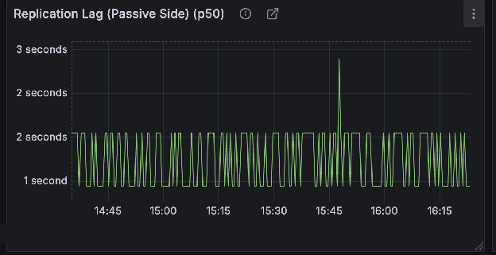
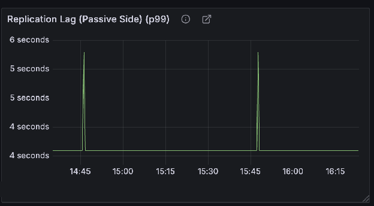

Cadence services are stateless, so their CPU, memory, and network use grows with the amount of work flowing through the cluster rather than with the number of workflows stored. This page explains what drives that usage and reports measurements from a reference benchmark, run once on a single cluster and once on two replicated clusters. Use the numbers to estimate a starting footprint, then confirm it with a bench run on your own hardware and datastore. Disk and datastore needs are covered on [Storage requirements](/docs/tech-review/day-0-planning/design/storage-requirements).

## Summary

- **Throughput.** The benchmark sustained about 610 decisions and 305 activities per second. The CPU, memory, datastore, and network figures below are for that load.
- **CPU.** A CPU core is one vCPU, usually one hardware thread. The four Cadence services had 26 CPU cores in total and averaged about 35% utilization, about 9 cores busy. History did about three quarters of that work.
- **Memory.** History is the memory-heavy service because it caches workflow state and history events for the shards it owns. It used 71% to 81% of its 96 GB allocation on average, and its busiest instance ran near 94% of its limit. Frontend, Matching, and Worker averaged under about 40% of their 2 GB. One minute on a Frontend instance reached about 43% of its memory limit, and one minute of Frontend or Matching CPU reached about 44%.
- **Datastore.** Cassandra ran as 3 nodes, 7 CPU cores and 64 GB each. One node had 60 GB. On the single-cluster run it averaged about 76% CPU and 62% memory, so it had less headroom than the Cadence services. It is the first component to scale as load grows.
- **Network.** The benchmark did not measure bandwidth. Traffic is RPC among workers, the Cadence services, and the datastore. With two clusters in different zones, cross-region bandwidth grows with the event rate and payload size, and that is what drives network cost.

## What drives resource usage

Cadence does its work per event. History writes every event to the workflow history, and Matching dispatches every task to a worker. CPU and memory therefore track the number of events and tasks in the system much more closely than the number of workflows. One workflow that fans out thousands of activities costs about as much as thousands of workflows that run one activity each.

The main drivers are:

- Decisions, activities, timers, and signals per second.
- Payload size, which affects history writes, caches, and persistence traffic.
- Workers polling, and the number of task lists they poll. Each waiting poll holds an open request on Frontend and Matching.
- The number of [history shards](/docs/operation-guide/setup#static-configuration). History keeps queues and caches per shard, so memory grows with the number of shards each instance owns and with the cache settings in dynamic configuration (`history.cacheMaxSize`, `history.executionCacheMaxByteSize`, `history.eventsCacheMaxSize`, and `history.eventsCacheMaxSizeInBytes`).
- One cluster or two. A standby cluster applies every replicated event, so it needs about as much History and datastore capacity as the active cluster. See [cross-DC replication](/docs/concepts/cross-dc-replication).

## Reference benchmark

The Cadence maintainers ran these tests in November 2026. Each run held a steady load for 100 to 110 minutes. They are sustained-load tests, not maximum-throughput tests: they show what one footprint used at one load, with headroom left on the Cadence services. Your workflow shapes, payload sizes, datastore, and hardware will move the numbers. The dynamic configuration and full counters are in [Benchmark details](#benchmark-details).

### Setup

Every cluster in the tests used the same footprint:

| Component | vCPU per instance | Memory per instance | Instances |
| --- | --- | --- | --- |
| Frontend | 1 | 2 GB | 5 |
| History | 2 | 12 GB | 8 |
| Matching | 1 | 2 GB | 3 |
| Worker (Cadence internal service) | 1 | 2 GB | 2 |
| Cassandra | 7 | 64 GB (one node had 60 GB) | 3 |
| Application workers running the bench workflows | 2 | 4 GB | 10 |

- **Cluster.** 8,192 history shards, Cassandra for persistence, and one benchmark domain with 30 days of retention.
- **Workload.** A nested workflow test configured with 400 child workflows, 2 activities per child workflow, 3 activities per grandchild workflow, and 1 KB payloads. It exercises child workflows, activities, timers, search attribute updates, and continue-as-new.
- **Workers.** Application workers were sized so task lists never built a backlog. Their own usage is not part of the results.
- **Configuration.** The bench used the dynamic configuration values in [Dynamic configuration](#dynamic-configuration). The replicated run set `history.ReplicationTaskProcessorShardQPS` to 50. That setting limits how many replication tasks each shard applies per second, and the default is 5.

The single-cluster run had no replication. The two-cluster run used a [global domain](/docs/concepts/cross-dc-replication) active in one cluster and replicated to a standby cluster in another region. The standby received no client traffic.

### Throughput

| Metric | Single cluster | Two clusters, active cluster |
| --- | --- | --- |
| Decisions completed per second | 611 | 613 |
| Activities completed per second | 306 | 307 |
| Workflows completed per second | 61 | 61 |
| Workflows continued as new per second | 61 | 61 |
| User timers fired per second | 61 | 61 |
| History tasks processed per second | 2,672 | 2,583 |
| Frontend requests per second, all APIs | 1,617 | 1,580 |
| Frontend requests per second, excluding long polls | 922 | 925 |
| Persistence requests per second | 5,359 | 5,434 |

No workflow or activity failed in either run.

### CPU and memory

Utilization is usage divided by allocation across all instances of a service, averaged over the run. "Used" multiplies that back out to CPU cores and GB.

#### Single cluster

| Service | Allocated | CPU used | Memory used | Busiest instance |
| --- | --- | --- | --- | --- |
| Frontend | 5 vCPU, 10 GB | 31% (1.6 vCPU) | 37% (3.7 GB) | 34% CPU, 38% memory |
| History | 16 vCPU, 96 GB | 41% (6.6 vCPU) | 71% (68 GB) | 48% CPU, 94% memory |
| Matching | 3 vCPU, 6 GB | 25% (0.7 vCPU) | 35% (2.1 GB) | 34% CPU, 36% memory |
| Worker | 2 vCPU, 4 GB | 9% (0.2 vCPU) | 31% (1.2 GB) | 9% CPU, 31% memory |
| **Cadence total** | **26 vCPU, 116 GB** | **9.1 vCPU** | **75 GB** | |
| Cassandra | 21 vCPU, 188 GB | 76% (16 vCPU) | 62% (117 GB) | 79% CPU, 68% memory |

"Busiest instance" is the highest per-instance average over the run, which shows how evenly load spread across instances.

#### Two clusters

| Service | Active cluster CPU | Active cluster memory | Standby cluster CPU | Standby cluster memory |
| --- | --- | --- | --- | --- |
| Frontend | 32% | 39% | 2% | 28% |
| History | 44% | 81% | 37% | 31%, rising |
| Matching | 25% | 35% | 2% | 24% |
| Worker | 8% | 31% | 12% | 24% |
| Cassandra | 73% | 61% | 62% | 61% |

What the measurements show:

- **History does most of the work.** It used about 7 of the 9 CPU cores Cadence consumed, and nearly all of the memory.
- **History memory fills up over time.** In the two-cluster run, History memory rose through the window as the per-shard caches filled, and one active History instance stayed near 94% of its limit. On the single-cluster run one History instance stayed near 94% for the whole window. Leave memory headroom on History, and bound the caches through dynamic configuration rather than relying on the container limit.
- **One task list skews Matching.** History work is spread across shards, so its instances stayed closer together (33% to 48% CPU on the single-cluster run). Matching follows task lists. This bench used one task list, so one Matching instance averaged 7% CPU and another 34%. More task lists spread that work. Size each Matching instance for the busiest one, not the average.
- **Replication adds little to the active cluster.** Compared with the single-cluster run, active History CPU rose from 41% to 44%, and Frontend and Matching did not change.
- **A standby cluster is not idle.** Its History applies every replicated event and verifies standby tasks, which took about 37% CPU, or roughly 85% of the active cluster's History CPU. Its datastore handled about 5,100 requests per second, close to the active cluster's 5,400. Give a standby cluster the same History and datastore capacity as the active one, which it needs anyway to take over traffic on failover.
- **The datastore was the most heavily used component.** At about 75% CPU, Cassandra had the least headroom, so it is the first component to scale as load grows.

### Latency and availability

These numbers confirm the footprint was not overloaded at this load. Percentiles come from server latency histograms, so each value is accurate to within one histogram bucket, roughly 10% to 20%.

| Measurement | Single cluster | Two clusters, active cluster |
| --- | --- | --- |
| Persistence latency, p50 / p99 | 4.8 ms / 19.0 ms | 4.8 ms / 19.0 ms |
| `RespondDecisionTaskCompleted` latency, p50 / p99 | 14.1 ms / 39.2 ms | 14.0 ms / 39.8 ms |
| `RespondActivityTaskCompleted` latency, p50 / p99 | 13.7 ms / 36.7 ms | 13.7 ms / 38.4 ms |
| Persistence availability, excluding "entity not exists" | 99.9998% | 99.99999% |

Frontend returned no "service busy", "service unavailable", or timeout errors in either run. The only API errors were a handful of "entity not exists" responses for tasks whose workflow had already moved on, which are client-side conditions rather than failures. In the standby cluster, which applies replicated writes, persistence latency was higher, at 15.6 ms p50 and 86.0 ms p99.

## Cross-cluster replication

In the two-cluster run, the standby cluster applied about 2,150 replication tasks per second: about 1,840 for replicated history events and about 310 for activity state. That was close to the rate at which the active cluster appended history, about 1,900 per second. End-to-end replication latency, from when the active cluster created a task to when the standby applied it, was 1.45 s at p50 and 3.84 s at p99, and stayed flat for the whole run. No shard fell behind.

The `replication_latency` gauge on the active cluster reports the age of each shard's oldest replication task not yet fetched by the standby. It read 0 for all 8,192 shards during this run.

## Network

The benchmark did not measure bandwidth. Request rates are in [Benchmark details](#benchmark-details). What follows is which paths have to exist. Cross-region bandwidth, and its cost, grows with the event rate and payload size when the two clusters are in different zones. Cadence uses no external message broker for task dispatch. Traffic is RPC between components, plus Kafka when advanced visibility is enabled.

### In-cluster

- **Workers to Frontend.** Workers open outbound connections to Frontend and long poll for tasks. Cadence never dials into a worker.
- **Between Cadence services.** Frontend, History, Matching, and Worker must all reach each other for RPC and for ringpop membership.
- **Cadence to the datastore.** Every service reaches the execution store. Frontend, History, and Worker also reach the visibility store, and Kafka when advanced visibility is enabled. Each process opens its own connection pool, so total database connections grow with the number of instances.

[Service dependencies](/docs/tech-review/day-0-planning/design/service-dependencies) lists every dependency and port.

### Cross-cluster

History and Worker in each cluster must reach Frontend in the other cluster. History pulls workflow replication tasks in batches, and Worker pulls domain replication messages. Frontend can also forward API calls to the cluster where a domain is active, depending on the cluster redirection policy. Datastores never talk to each other across clusters. Cadence replicates workflow data itself, which lets the clusters use different databases and makes moving from one database to another a [cluster migration](/docs/operation-guide/migration).

Replication is asynchronous. Latency between regions does not slow running workflows, but it adds to replication lag, which is how much recent progress a failover can lose. Replication traffic grows with the event rate.

## Sizing guidelines

Treat these as starting points:

- Start History with at least 2 CPU cores and enough memory for its caches. In the benchmark, 12 GB per instance with 1,024 shards per instance ran close to the limit on the busiest instance.
- Frontend, Matching, and Worker are light at 1 CPU core and 2 GB per instance. Service averages stayed under about 40%. One-minute peaks reached about 44% CPU on Frontend and Matching, and about 43% of Frontend memory.
- [Architecture requirements](/docs/tech-review/day-0-planning/design/architecture-requirements#production) recommends at least 4 instances each of Frontend, History, and Matching. Run at least 2 Worker instances as well, so internal workflows keep running if one instance is lost. Load spreads more evenly across more instances.
- Size the datastore first. In the benchmark, it had the least headroom of any component.
- With two clusters, give the standby the same History and datastore capacity as the active cluster.
- Before provisioning, run the [bench suite](/docs/operation-guide/setup#stressbench-test-a-cluster) against your own hardware, datastore, and workflow shapes, and run it again whenever the setup changes. The official [Helm chart](https://github.com/cadence-workflow/cadence-charts) sets no CPU or memory requests by default, so set them from your bench results.

[Cluster monitoring](/docs/operation-guide/monitoring) shows how to chart decision, activity, and persistence rates and per-service resource use on your own cluster.

## Benchmark details

The sections above summarize the two runs. This section records the dynamic configuration and the counters behind those summaries.

Percentiles come from server latency histograms, so each value is accurate to within one histogram bucket, roughly 10% to 20%. Counts are totals over the window. Per-second figures divide that total by the length of the window. CPU and memory are container usage divided by the allocation.

### Dynamic configuration

These are the values used for both runs. The two-cluster run also set `history.ReplicationTaskProcessorShardQPS` to 50. Several differ from the compiled defaults. New behavior usually ships behind a dynamic configuration flag, and when scalability improves, the ceiling is raised there instead of by changing the default.

| Key | Value |
| --- | --- |
| `frontend.globalDomainrps` | 20000 |
| `frontend.globalRatelimiterMode` | global-shadow-local |
| `frontend.persistenceGlobalMaxQPS` | 30000 |
| `history.enableTaskListAwareTaskSchedulerByDomain` | true |
| `history.enableTransferQueueV2PendingTaskCountAlert` | true |
| `history.eventsCacheMaxSizeInBytes` | 1048576 (1 MiB) |
| `history.executionCacheMaxByteSize` | 1048576 (1 MiB) |
| `history.persistenceGlobalMaxQPS` | 500000 |
| `history.replicationBudgetManagerMaxSizeBytes` | 104857600 (100 MiB) |
| `history.replicationBudgetManagerMaxSizeCount` | 1000000 |
| `history.replicatorCacheCapacity` | 10000 |
| `history.replicatorCacheMaxSize` | 1073741824 (1 GiB) |
| `history.ReplicationTaskProcessorShardQPS` | 50, two-cluster run only |
| `history.rewriteSampleRate` | 100 |
| `history.serializationEncoding` | thriftrw_snappy |
| `history.taskProcessRPS` | 1000000 |
| `history.workflowIDExternalRPS` | 100 |
| `history.workflowIDInternalRPS` | 1000 |
| `matching.enableAdaptiveScaler` | true |
| `matching.enableClientAutoConfig` | true |
| `matching.enableGetNumberOfPartitionsFromCache` | true |
| `matching.localPollWaitTime` | 5ms |
| `matching.partitionDownscaleSustainedDuration` | 1m |
| `matching.persistenceGlobalMaxQPS` | 30000 |
| `system.enableConnectionRetainingDirectChooser` | true |
| `system.minRetentionDays` | 0 |

### Single cluster

100 minutes. Per-second figures divide the total by 6,000. Replication was off.

#### CPU and memory

"Avg" is total usage divided by the total allocation across all instances. "Per instance avg" is the lowest and highest per-instance average over the window. "1-min min / max" is the lowest and highest single minute on any instance.

| Service | Instances | CPU avg | CPU per instance avg | CPU 1-min min / max | Mem avg | Mem per instance avg | Mem 1-min min / max |
| --- | --- | --- | --- | --- | --- | --- | --- |
| Frontend | 5 | 31.3% | 29.3-33.9% | 24.4% / 44.2% | 36.6% | 35.3-38.3% | 34.5% / 39.7% |
| History | 8 | 41.3% | 33.1-48.2% | 29.0% / 71.3% | 71.1% | 59.4-93.8% | 59.3% / 93.9% |
| Matching | 3 | 24.5% | 7.1-34.0% | 6.3% / 43.4% | 35.3% | 34.7-36.0% | 34.0% / 36.7% |
| Worker | 2 | 8.5% | 8.4-8.5% | 7.6% / 10.8% | 30.8% | 30.6-31.1% | 30.2% / 32.6% |
| Cassandra | 3 nodes | 75.9% | 72.6-78.9% | 57.5% / 88.2% | 62.0% | 53.9-67.6% | 49.6% / 73.9% |

Whole-service CPU stayed in a narrow band each minute: Frontend 30-34%, History 38-44%, Matching 24-28%, Worker 8-10%. Cassandra ranged from 59% to 83% because it dipped to about 59-62% twice.

#### Workflows, decisions, activities, and timers

| Metric | Total | Per second |
| --- | --- | --- |
| Decisions completed | 3,668,497 | 611.4 |
| Activities completed | 1,834,257 | 305.7 |
| Activities failed | 0 | 0 |
| Workflows completed | 366,898 | 61.2 |
| Workflows continued as new | 366,889 | 61.2 |
| Workflows failed / timed out / terminated | 0 / 0 / 0 | 0 |
| User timers fired | 366,889 | 61.2 |

About 75% of activities were locally dispatched: 466,265 `TransferActivity` tasks for 1,834,257 completed activities.

#### History tasks

Counts include retries, so a task that is tried again is counted more than once. 7 task errors occurred in the window.

| Task type | Total | Per second |
| --- | --- | --- |
| TimerDecisionTimeout | 6,602,903 | 1,100.5 |
| TransferDecision | 3,668,473 | 611.4 |
| TimerActivityTimeout | 2,310,112 | 385.0 |
| TransferRecordWorkflowStarted | 733,799 | 122.3 |
| TransferCloseExecution | 733,789 | 122.3 |
| TransferActivity | 466,265 | 77.7 |
| TimerWorkflowTimeout | 369,326 | 61.6 |
| TransferUpsertSearchAttributes | 366,910 | 61.2 |
| TransferStartChildExecution | 366,895 | 61.2 |
| TimerUserTimer | 366,889 | 61.2 |
| TimerDeleteHistoryEvent | 47,465 | 7.9 |
| TimerActivityRetryTimer | 4 | 0.0 |
| **Total** | **16,032,830** | **2,672.1** |

Processing time is the time spent executing the task. Queue time is end to end, from when the task was due until it finished. Both are p50 / p99, in milliseconds.

| Task type | Processing | Queue |
| --- | --- | --- |
| TransferDecision | 15.5 / 42.6 | 24.2 / 60.4 |
| TransferActivity | 12.9 / 32.0 | 21.3 / 53.2 |
| TransferRecordWorkflowStarted | 13.1 / 33.9 | 21.9 / 56.0 |
| TransferCloseExecution | 16.2 / 44.8 | 24.0 / 61.9 |
| TransferUpsertSearchAttributes | 7.7 / 25.9 | 15.8 / 41.2 |
| TransferStartChildExecution | 40.2 / 88.9 | 48.6 / 114.2 |
| TimerUserTimer | 11.4 / 31.3 | 12.1 / 32.0 |
| TimerDecisionTimeout | 0.5 / 1.0 | 0.6 / 10.5 |
| TimerActivityTimeout | 0.5 / 1.0 | 0.6 / 10.2 |
| TimerWorkflowTimeout | 2.5 / 11.3 | 3.3 / 16.3 |
| TimerDeleteHistoryEvent | 30.0 / 63.0 | 30.6 / 63.7 |

#### Frontend

| API | Requests | Per second |
| --- | --- | --- |
| **All APIs** | **9,701,898** | **1,617.0** |
| All APIs except long polls | 5,531,895 | 922.0 |
| PollForDecisionTask | 3,685,466 | 614.2 |
| RespondDecisionTaskCompleted | 3,666,665 | 611.1 |
| RespondActivityTaskCompleted | 1,834,179 | 305.7 |
| PollForActivityTask | 484,537 | 80.8 |
| Other (replication, heartbeat) | 31,051 | 5.2 |

| API | p50 (ms) | p99 (ms) | Errors | Availability |
| --- | --- | --- | --- | --- |
| RespondDecisionTaskCompleted | 14.1 | 39.2 | 7 | 99.99981% |
| RespondActivityTaskCompleted | 13.7 | 36.7 | 3 | 99.99984% |

All 10 errors were "entity not exists": the task or workflow was already gone. There were no "service busy", "service unavailable", or timeout errors. Excluding those client-side errors, both APIs were at 100%.

#### Persistence

| Operation | Requests | Per second |
| --- | --- | --- |
| **All operations** | **32,150,959** | **5,358.5** |
| AppendHistoryNodes | 11,372,301 | 1,895.4 |
| UpdateWorkflowExecution | 11,104,806 | 1,850.8 |
| ReadHistoryBranch | 3,667,084 | 611.2 |
| GetHistoryTasks | 2,030,318 | 338.4 |
| RangeCompleteHistoryTask | 2,022,159 | 337.0 |
| GetWorkflowExecution | 979,073 | 163.2 |
| All other operations | 975,218 | 162.5 |

| Scope | Requests | p50 (ms) | p99 (ms) |
| --- | --- | --- | --- |
| All services, all operations | 32.15M | 4.8 | 19.0 |
| History | 28.43M | 5.0 | 19.6 |
| Frontend | 3.69M | 3.7 | 14.6 |
| Matching | 36K | 5.1 | 18.7 |
| AppendHistoryNodes | 11.37M | 3.0 | 12.5 |
| UpdateWorkflowExecution | 11.11M | 7.4 | 22.3 |

| Category | Count | Availability |
| --- | --- | --- |
| Requests | 32,150,959 | |
| Unexpected errors, all 51 timeouts | 51 | 99.99984% |
| Also counting "entity not exists" (4,616) | 4,667 | 99.9855% |

"Entity not exists" means the record was not there, for example a workflow that had already closed. Those are not counted as failures.

### Two clusters, active cluster

110 minutes. Per-second figures divide the total by 6,600. This cluster served all client traffic.

#### CPU and memory

| Service | Instances | CPU avg | CPU per instance avg | CPU 1-min min / max | Mem avg | Mem per instance avg | Mem 1-min min / max |
| --- | --- | --- | --- | --- | --- | --- | --- |
| Frontend | 5 | 31.7% | 29.9-33.9% | 24.7% / 41.3% | 39.4% | 38.3-41.0% | 37.5% / 42.9% |
| History | 8 | 43.6% | 35.1-50.8% | 30.3% / 68.5% | 80.7% | 65.2-94.4% | 63.5% / 94.7% |
| Matching | 3 | 25.1% | 23.0-28.9% | 14.7% / 42.4% | 35.2% | 35.2-35.4% | 34.1% / 36.8% |
| Worker | 2 | 8.4% | 8.4-8.4% | 7.6% / 10.8% | 30.9% | 30.9-30.9% | 30.3% / 31.9% |
| Cassandra | 3 nodes | 73.0% | 72.2-74.2% | 67.8% / 79.8% | 61.2% | 52.8-72.0% | 45.6% / 89.4% |

History memory rose through the window, from 78.5% to 82.7%. Cassandra memory varied from 52.4% to 73.6%. Matching CPU spiked once to 35%.

#### Workflows, decisions, activities, and timers

| Metric | Total | Per second |
| --- | --- | --- |
| Decisions completed | 4,048,209 | 613.4 |
| Activities completed | 2,023,709 | 306.6 |
| Activities failed | 0 | 0 |
| Workflows completed | 404,812 | 61.3 |
| Workflows continued as new | 404,797 | 61.3 |
| Workflows failed / timed out / terminated | 0 / 0 / 0 | 0 |
| User timers fired | 404,839 | 61.3 |

About 88.5% of activities were locally dispatched: 232,290 `TransferActivity` tasks for 2,023,709 completed activities.

#### History tasks

6 task errors occurred in the window.

| Task type | Total | Per second |
| --- | --- | --- |
| TimerDecisionTimeout | 7,286,184 | 1,104.0 |
| TransferDecision | 4,048,210 | 613.4 |
| TimerActivityTimeout | 2,250,336 | 341.0 |
| TransferRecordWorkflowStarted | 809,592 | 122.7 |
| TransferCloseExecution | 809,503 | 122.7 |
| TimerUserTimer | 404,839 | 61.3 |
| TransferUpsertSearchAttributes | 404,827 | 61.3 |
| TransferStartChildExecution | 404,761 | 61.3 |
| TimerWorkflowTimeout | 393,888 | 59.7 |
| TransferActivity | 232,290 | 35.2 |
| TimerDeleteHistoryEvent | 11 | 0.0 |
| **Total** | **17,044,441** | **2,582.5** |

| Task type | Processing (p50 / p99, ms) | Queue (p50 / p99, ms) |
| --- | --- | --- |
| TransferDecision | 15.4 / 43.1 | 24.1 / 60.1 |
| TransferActivity | 12.7 / 39.2 | 20.9 / 57.5 |
| TransferRecordWorkflowStarted | 13.3 / 41.7 | 21.8 / 60.2 |
| TransferCloseExecution | 16.5 / 54.5 | 24.3 / 63.9 |
| TransferUpsertSearchAttributes | 8.0 / 30.8 | 16.0 / 44.4 |
| TransferStartChildExecution | 40.2 / 89.5 | 48.8 / 113.3 |
| TimerUserTimer | 11.2 / 30.9 | 11.9 / 31.9 |
| TimerDecisionTimeout | 0.5 / 1.0 | 0.6 / 11.3 |
| TimerActivityTimeout | 0.5 / 1.0 | 0.6 / 11.2 |
| TimerWorkflowTimeout | 2.9 / 15.3 | 3.6 / 21.2 |

#### Frontend

| API | Requests | Per second |
| --- | --- | --- |
| **All APIs** | **10,426,089** | **1,579.7** |
| All APIs except long polls | 6,105,644 | 925.1 |
| PollForDecisionTask | 4,067,936 | 616.4 |
| RespondDecisionTaskCompleted | 4,047,833 | 613.3 |
| RespondActivityTaskCompleted | 2,023,898 | 306.7 |
| PollForActivityTask | 252,509 | 38.3 |
| Other (replication, heartbeat) | 33,913 | 5.1 |

| API | p50 (ms) | p99 (ms) | Errors | Availability |
| --- | --- | --- | --- | --- |
| RespondDecisionTaskCompleted | 14.0 | 39.8 | 0 | 100% |
| RespondActivityTaskCompleted | 13.7 | 38.4 | 0 | 100% |

#### Persistence

| Operation | Requests | Per second |
| --- | --- | --- |
| **All operations** | **35,864,338** | **5,434.0** |
| AppendHistoryNodes | 12,548,268 | 1,901.3 |
| UpdateWorkflowExecution | 11,970,978 | 1,813.8 |
| ReadHistoryBranch | 4,047,715 | 613.3 |
| GetHistoryTasks | 3,278,520 | 496.8 |
| RangeCompleteHistoryTask | 2,156,432 | 326.7 |
| GetWorkflowExecution | 1,023,674 | 155.1 |
| All other operations | 838,751 | 127.1 |

| Scope | Requests | p50 (ms) | p99 (ms) |
| --- | --- | --- | --- |
| All services, all operations | 35.86M | 4.8 | 19.0 |
| History | 31.75M | 5.1 | 19.7 |
| Frontend | 4.07M | 3.6 | 12.9 |
| Matching | 42K | 4.9 | 16.8 |
| AppendHistoryNodes | 12.55M | 2.9 | 12.8 |
| UpdateWorkflowExecution | 11.97M | 7.3 | 21.6 |
| GetHistoryTasks | 3.28M | 6.6 | 22.8 |

| Category | Count | Availability |
| --- | --- | --- |
| Requests | 35,864,338 | |
| Unexpected errors | 3 | 99.99999% |
| Also counting "entity not exists" | 5,070 | 99.9859% |

### Two clusters, standby cluster

Same 110-minute window. The standby applied replicated changes and ran standby tasks. It completed no decisions and no activities.

#### CPU and memory

| Service | Instances | CPU avg | CPU per instance avg | CPU 1-min min / max | Mem avg | Mem per instance avg | Mem 1-min min / max |
| --- | --- | --- | --- | --- | --- | --- | --- |
| Frontend | 5 | 2.1% | 2.0-2.3% | 1.7% / 9.7% | 28.4% | 27.5-29.5% | 26.2% / 32.5% |
| History | 8 | 36.6% | 30.5-46.4% | 27.4% / 53.5% | 30.5% | 25.4-40.7% | 21.0% / 47.9% |
| Matching | 3 | 1.5% | 1.4-1.5% | 1.1% / 4.5% | 24.4% | 23.5-24.8% | 23.1% / 27.5% |
| Worker | 2 | 12.0% | 11.7-12.3% | 8.6% / 15.0% | 24.3% | 24.1-24.4% | 23.4% / 24.9% |
| Cassandra | 3 nodes | 62.0% | 53.4-66.7% | 48.7% / 71.1% | 61.2% | 61.1-61.4% | 55.3% / 67.2% |

History memory climbed from 25.8% in the first 10 minutes to 35.1% in the last 10.

#### Workflows and history tasks

| Metric | Total | Per second |
| --- | --- | --- |
| Decisions completed | 0 | 0 |
| Activities completed | 0 | 0 |
| Workflows completed (replicated closes) | 404,815 | 61.3 |
| Workflows continued as new (replicated closes) | 404,806 | 61.3 |
| Workflows failed / timed out / terminated | 0 / 0 / 0 | 0 |
| User timers fired | 0 | 0 |

The completed workflows are closes replicated from the active cluster, not workflows that ran on the standby.

| Task type | Total | Per second |
| --- | --- | --- |
| TransferStandbyDecision | 4,144,162 | 627.9 |
| TimerStandbyDecisionTimeout | 4,048,279 | 613.4 |
| TimerStandbyActivityTimeout | 3,923,645 | 594.5 |
| TransferStandbyActivity | 2,048,081 | 310.3 |
| TransferStandbyRecordWorkflowStarted | 809,622 | 122.7 |
| TransferStandbyCloseExecution | 809,526 | 122.7 |
| TimerStandbyUserTimer | 596,835 | 90.4 |
| TransferStandbyStartChildExecution | 421,398 | 63.8 |
| TransferStandbyUpsertSearchAttributes | 404,808 | 61.3 |
| TimerStandbyWorkflowTimeout | 394,043 | 59.7 |
| **Total** | **17,600,399** | **2,666.7** |

There were few re-checks, because replication was keeping up. `TransferStandbyDecision` ran 4.14 million times for 4.05 million tasks.

A p99 near 25 to 33 seconds is how long a standby task waits for the matching change to arrive from the active cluster, not processing time.

| Task type | Processing (p50 / p99, ms) | Queue (p50 / p99, ms) |
| --- | --- | --- |
| TransferStandbyDecision | 41.4 / about 28,700 | 73.1 / about 28,700 |
| TransferStandbyActivity | 16.7 / about 24,800 | 61.0 / about 24,800 |
| TransferStandbyRecordWorkflowStarted | 68.8 / 293.6 | 107.4 / 410.9 |
| TransferStandbyCloseExecution | 16.1 / 105.7 | 45.9 / 226.4 |
| TransferStandbyUpsertSearchAttributes | 38.4 / 219.6 | 86.7 / 361.6 |
| TransferStandbyStartChildExecution | 35.2 / about 30,400 | 62.5 / about 30,400 |
| TimerStandbyUserTimer | 102.8 / about 32,600 | 169.8 / about 32,600 |
| TimerStandbyDecisionTimeout | 0.5 / 40.9 | 0.9 / 64.0 |
| TimerStandbyActivityTimeout | 0.5 / 39.0 | 0.8 / 55.3 |
| TimerStandbyWorkflowTimeout | 2.5 / 80.6 | 3.7 / 94.4 |

#### Frontend and persistence

The standby Frontend served replication fetches, not worker traffic.

| API | Requests | Per second |
| --- | --- | --- |
| **All APIs** | **54,011** | **8.2** |
| GetReplicationMessages | 24,118 | 3.7 |
| PollForDecisionTask | 11,888 | 1.8 |
| PollForActivityTask | 11,881 | 1.8 |
| GetDomainReplicationMessages | 6,119 | 0.9 |
| DescribeDomain | 5 | 0.0 |

| Operation | Requests | Per second |
| --- | --- | --- |
| **All operations** | **33,936,224** | **5,141.9** |
| UpdateWorkflowExecution | 13,764,939 | 2,085.6 |
| AppendHistoryNodes | 12,550,420 | 1,901.6 |
| GetHistoryTasks | 3,067,371 | 464.8 |
| RangeCompleteHistoryTask | 2,293,556 | 347.5 |
| GetWorkflowExecution | 1,026,465 | 155.5 |
| All other operations | 1,233,473 | 186.9 |

| Scope | Requests | p50 (ms) | p99 (ms) |
| --- | --- | --- | --- |
| All services, all operations | 33.93M | 15.6 | 86.0 |
| History | 33.88M | 15.6 | 86.0 |
| Frontend | 33K | 3.8 | 33.9 |
| Matching | 20K | 4.0 | 40.2 |
| UpdateWorkflowExecution | 13.76M | 21.6 | 92.4 |
| AppendHistoryNodes | 12.55M | 13.7 | 79.7 |
| GetHistoryTasks | 3.07M | 6.5 | 73.4 |

| Category | Count | Availability |
| --- | --- | --- |
| Requests | 33,936,224 | |
| Unexpected errors | 1 | 99.99999% |
| Also counting "entity not exists" | 413,143 | 98.78% |

About 405,000 of the "entity not exists" errors are the expected lookup for a current workflow when a replicated workflow is created.

#### Replication

| Task type | Total | Per second |
| --- | --- | --- |
| HistoryReplicationV2 | 12,144,349 | 1,840.1 |
| SyncActivity | 2,024,069 | 306.7 |
| **Total** | **14,168,418** | **2,146.7** |

| Metric | What it measures | Count | p50 | p99 |
| --- | --- | --- | --- | --- |
| Replication task latency, all types | From creation on the active cluster to apply on the standby | 14.17M | 1.45 s | 3.84 s |
| HistoryReplicationV2 | Replicated history events | 12.14M | 1.44 s | 3.83 s |
| SyncActivity | Activity state sync | 2.02M | 1.55 s | 3.90 s |
| Fetch latency | One standby fetch from the active cluster | 25K | 100 ms | 232 ms |
| Apply latency | Applying one fetched batch | 1.89M | 305 ms | 1.2 s |

In every 10-minute slice, p50 was 1.44-1.48 s and p99 was 3.8-3.9 s. The active cluster's replication lag gauge read 0 for all 8,192 shards.

p50 stayed between about 1 and 2 seconds, with one spike to about 3 seconds.

p99 stayed near 4 seconds, with two spikes to about 6 seconds.

## Related documentation

- [Architecture requirements](/docs/tech-review/day-0-planning/design/architecture-requirements)
- [Service dependencies](/docs/tech-review/day-0-planning/design/service-dependencies)
- [High availability](/docs/tech-review/day-0-planning/design/high-availability)
- [Storage requirements](/docs/tech-review/day-0-planning/design/storage-requirements)
- [Cluster configuration](/docs/operation-guide/setup)
- [Cluster monitoring](/docs/operation-guide/monitoring)
- [Cross-DC replication](/docs/concepts/cross-dc-replication)
- [Cadence bench suite](https://github.com/cadence-workflow/cadence/tree/master/bench)
